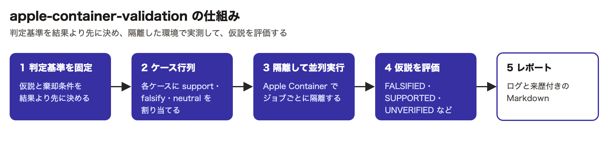
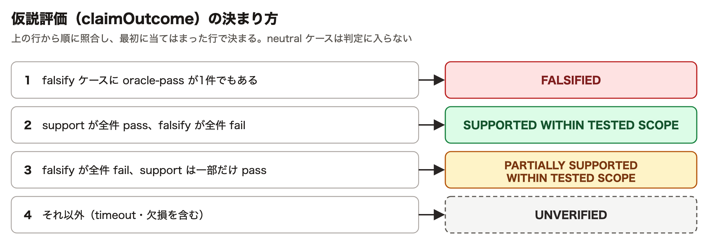
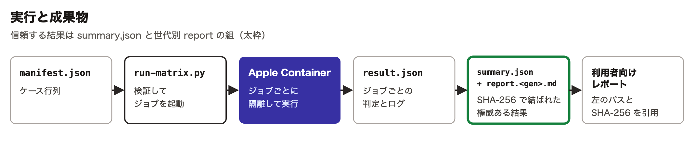

# apple-container-validation

Apple Container 上に再現可能な技術検証環境を構築し、コンテキストから論点・反証条件・オラクル・ケース行列を定義して、独立ケースを安全な上限内で並列実行し、ログと来歴を伴う Markdown レポートへ集約するエージェントスキル。

[vercel-labs/skills](https://github.com/vercel-labs/skills) CLI（`npx skills`）に対応する。

## 仕組み



仮説評価は、ジョブの結果を上の行から順に照合して決まる。前提条件を含む規則の全体は `skills/apple-container-validation/SKILL.md` の手順7にある。



実行時は次の順で成果物ができる。信頼する結果は `summary.json` と世代別 report の組である。



## 由来

[53able/skills](https://github.com/53able/skills) の `skills/apple-container-validation`（コミット `f17a12d` 時点）を、該当パスのコミット履歴を保持したまま切り出したもの。

## 要件

- Apple silicon Mac / macOS 26 以降
- Apple Container CLI
- Python 3.10 以上
- 依存のある Python ハーネスでは uv、TypeScript ハーネスでは Node.js・npm・TypeScript 7・tsx・pino

## 構成

```
skills/apple-container-validation/
├── SKILL.md        # スキル本体
├── references/     # コマンド・マニフェスト仕様・ケース設計・実行規約
├── assets/         # マニフェスト/レポートのテンプレート、agent-cli 用 Containerfile
├── scripts/        # validate-manifest.py, run-matrix.py
├── tests/          # 標準ライブラリのみのユニットテスト
└── evals/          # skill-creator / claude plugin eval 形式の実機評価ケース
```

## インストール

```bash
npx skills add 53able/apple-container-validation -g
```

`-g` はユーザー単位（全プロジェクト共通）でインストールする。特定のプロジェクトだけで使う場合は、そのプロジェクトのルートで `-g` を付けずに実行する。

スキルを開発・変更する場合は、クローンしたリポジトリのルートから入れる。

```bash
git clone https://github.com/53able/apple-container-validation.git
cd apple-container-validation
npx skills add ./ -g
```

## テスト

リポジトリルートで実行する。Apple Container は起動しない。

```bash
python3 -m unittest discover -s skills/apple-container-validation/tests -p 'test_*.py'
```

## ライセンス

MIT（[LICENSE](LICENSE)）。
